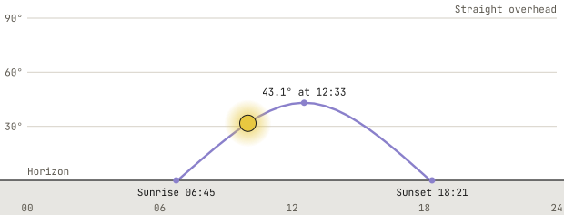

# The Sun's Altitude

Each minute, the plugin computes the sun's altitude at your place through [`astronomy-engine`](https://www.npmjs.com/package/astronomy-engine), with no request to any service. The altitude is the sun's height above the horizon in degrees, taken before any correction for the air bending its light, since [the clear-sky curve](./clear-sky.md) applies a correction of its own. The plugin's test suite holds that altitude to the Solar Position Algorithm of Reda and Andreas, at instants across a year, at latitudes in both hemispheres, and at twilight altitudes.[^reda2008]

## The Sun's Height Through the Day

<!-- sun-lede -->

On October 4, the sun climbs to **43.1°** at **12:33**, a little under half the way from the horizon to straight overhead.

<!-- /sun-lede -->

<!-- sun-table -->

| **Day** | **Sunrise** | **Highest** | **Sunset** |
|---|---|---|---|
| March 20 | 06:48 | 47.7° at 12:52 | 18:57 |
| June 21 | 05:08 | 71.1° at 12:46 | 20:25 |
| September 22 | 06:32 | 47.8° at 12:37 | 18:42 |
| October 4 | 06:45 | 43.1° at 12:33 | 18:21 |
| December 21 | 07:11 | 24.2° at 11:42 | 16:15 |

<!-- /sun-table -->

Each curve runs the plugin's own position code at the zip code [Finding Your Place](../install/place.md) searches for, on the local clock.

[^reda2008]: Reda and Andreas. 2008. "Solar Position Algorithm for Solar Radiation Applications (Revised)." National Renewable Energy Laboratory, NREL/TP-560-34302. <https://doi.org/10.2172/15003974>
