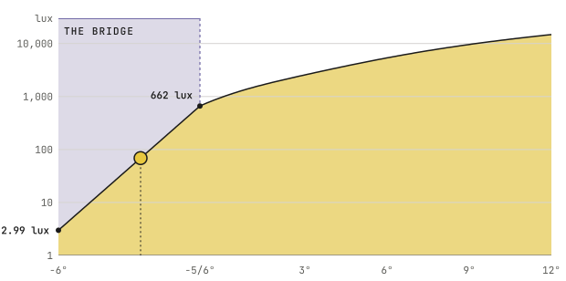

# The Clear-Sky Curve

The clear-sky curve gives the brightness of a clear sky on level ground, in lux, from the sun's altitude alone, through full daylight and twilight. It is the sun illuminance model of U.S. Naval Observatory Circular 171,[^janiczek1987] which corrects the altitude for the air bending the sun's light and then attenuates that light through the air at that altitude. The plugin writes the circular's equations in TypeScript, and its test suite checks them against the figures the circular prints, among them the cases of its Table A that the suite of the [`skylight`](https://cran.r-project.org/package=skylight) package pins.[^hufkens2023]

## Levels for a Threshold

A threshold sensor's level is usually set against one of these moments on the curve, each with the decade of [the Lux Scale](../sensors/outside.md#nine-decades-of-lux) it falls in.

<!-- curve-levels -->

| **Moment** | **The Sun's Altitude** | **Clear Sky** | **Decade** |
|---|---|---|---|
| The end of civil twilight | −6.0° | 2.99 lux | [1 to 10 lux](../sensors/outside.md#nine-decades-of-lux) |
| Sunset | −5/6° | 662 lux | [100 to 1,000 lux](../sensors/outside.md#nine-decades-of-lux) |
| A low sun | 10.0° | 11,231 lux | [10,000 to 100,000 lux](../sensors/outside.md#nine-decades-of-lux) |

<!-- /curve-levels -->

## The Twilight Bridge

<!-- bridge-words -->

Below an altitude of −5/6°, the circular's refraction correction adds nothing, so its refracted altitude steps by about 0.61° there and its lux jumps. The plugin keeps the circular's curve at and below −6°, the end of civil twilight, and at and above −5/6°. Between the two, the logarithm of the lux runs in a straight line against the altitude, from the circular's 2.99 lux to its 662 lux, so the reading climbs through the cutoff without a step.

<!-- /bridge-words -->

<!-- bridge-table -->

| **The Sun's Altitude** | **Clear Sky** |
|---|---|
| −6.0° | 2.99 lux |
| −5.0° | 8.51 lux |
| −4.0° | 24.2 lux |
| −3.0° | 68.8 lux |
| −2.0° | 196 lux |
| −1.0° | 556 lux |
| −5/6° | 662 lux |
| 0.0° | 984 lux |
| 5.0° | 4,252 lux |
| 10.0° | 11,231 lux |

<!-- /bridge-table -->

[^janiczek1987]: Janiczek and DeYoung. 1987. "Computer Programs for Sun and Moon Illuminance With Contingent Tables and Diagrams." U.S. Naval Observatory, Circular 171. <https://archive.org/details/DTIC_ADA182110>

[^hufkens2023]: Hufkens et al. 2023. "Evaluating the effects of moonlight on the vertical flight profiles of three western palaearctic swifts." *Proceedings of the Royal Society B* 290 (2010): 20230957. <https://doi.org/10.1098/rspb.2023.0957>
