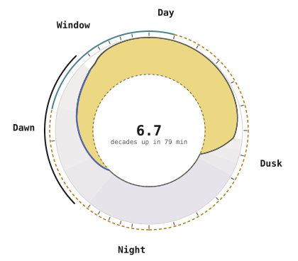

# Estimate

Where does the reading come from, and where does it stop? This section covers the altitude of the sun, the clear-sky curve, the cloud factor, the forecast window, what the reading uses while fetches fail, the limits of an estimate, and the bibliography that credits its sources.

- [Bibliography](./bibliography.md) lists each work these pages rest on and credits [Open-Meteo](https://open-meteo.com/en/docs) and [GeoNames](https://www.geonames.org/).
- [The Clear-Sky Curve](./clear-sky.md) says how bright a clear sky is at each altitude of the sun and what it reads at the levels a threshold is set against.
- [The Cloud Factor](./cloud-factor.md) says how each step of the forecast becomes the share of a clear sky's light the clouds let through.
- [The Forecast Window](./forecast-window.md) says what each fetch stores and how far ahead it reaches.
- [The Limits of the Estimate](./limits.md) says where the reading can differ from the light you see.
- [The Sun's Altitude](./altitude.md) says how the plugin finds the sun's height each minute.
- [While Fetches Fail](./failed-fetches.md) says what the reading uses when no forecast arrives.

[Settings](../settings/) comes before this section with what each setting does.

## Three Factors

Each minute's reading is the clear-sky illuminance at the sun's altitude times the cloud factor, clamped into [the range HomeKit accepts](https://developers.homebridge.io/#/characteristic/CurrentAmbientLightLevel). The clear sky comes from U.S. Naval Observatory Circular 171,[^janiczek1987] and the cloud factor from [Open-Meteo](https://open-meteo.com/en/docs)'s forecast over the Haurwitz clear-sky model.[^reno2012]

<!-- factor-table -->

| **Term** | **At 10:00** | **Comes From** |
|---|---|---|
| Clear sky | 54,825 lux | Circular 171 gives the clear sky’s lux from the sun’s altitude alone, and the sample day’s sun peaks at 43.1°. |
| Cloud factor | 0.888 | Each 15-minute step divides the forecast’s sunlight by a clear sky’s, and a minute takes the factor on the line between its two steps, or 1 where no stored window covers it. |
| Reading | 48,684 lux | HomeKit accepts 0.0001 to 100,000 lux, so the plugin clamps the clear sky times the factor into that range before writing it. |

<!-- /factor-table -->

## A Day of the Reading

The reading follows the clear-sky curve from the night's floor through each twilight to noon and back, scaled by the cloud factor wherever a stored window covers the minute.

<!-- dial-lede -->

The dial draws October 4 at the zip code [Finding Your Place](../install/place.md) searches for. The reading holds at HomeKit's floor of 0.0001 lux from 19:40 to 05:26 and climbs and falls through each twilight. It runs under the clear sky by the forecast's share inside the one stored window, 06:15 to 13:00, and follows the clear-sky curve alone outside it, as the plugin does wherever no stored window covers a minute.

<!-- /dial-lede -->

<!-- dial-table -->

| **Stretch** | **Minutes** | **The Reading** | **What It Does There** |
|---|---|---|---|
| Night | 19:40–05:26 | 0.0001 lux at HomeKit’s floor | The clear sky sinks to 3.8 × 10⁻¹⁹ lux at 00:33, 14.4 decades under the lowest value HomeKit accepts, so the reading is clamped up to that floor. |
| Dawn | 05:26–06:45 | 6.7 decades up in 79 min | The sun climbs the 14.5° from −15.3° to sunrise, and the clear sky’s light rises about 0.47 decades with each degree, lifting the reading off HomeKit’s floor to 535 lux. |
| Window | 06:15–13:00 | 0.748–1 of the clear sky | Each 15-minute step divides Open-Meteo’s forecast sunlight by the clear sky’s, a step with the sun under 5° takes 0.785, the mean of the 4 nearest, and from 13:00, the factor is 1. |
| Day | 06:45–18:21 | 72,809 lux at noon, sun at 42.5° | By day, the clear sky follows the sun’s height, and the reading follows the clear sky, under it by the forecast’s share until 13:00 and on it from then to sunset. |
| Dusk | 18:21–19:40 | 6.8 decades down in 79 min | The sun sinks from sunset to −15.5°, and with no stored window over these minutes, the reading is the clear sky alone, falling until it meets HomeKit’s floor at 19:40. |

<!-- /dial-table -->

[^janiczek1987]: Janiczek and DeYoung. 1987. "Computer Programs for Sun and Moon Illuminance With Contingent Tables and Diagrams." U.S. Naval Observatory, Circular 171. <https://archive.org/details/DTIC_ADA182110>

[^reno2012]: Reno, Hansen, and Stein. 2012. "Global Horizontal Irradiance Clear Sky Models: Implementation and Analysis." Sandia National Laboratories, SAND2012-2389. <https://doi.org/10.2172/1039404>
