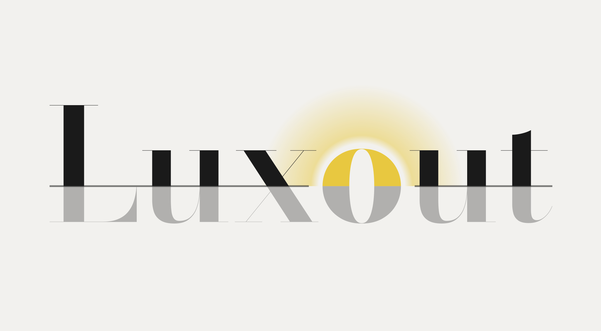
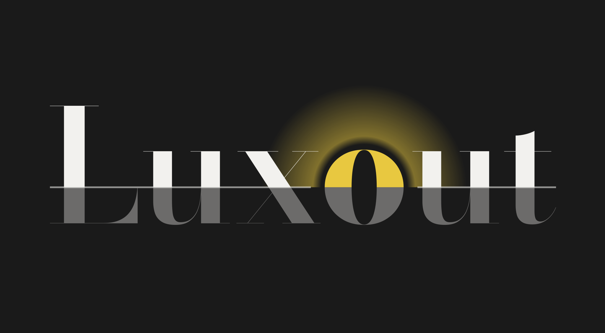
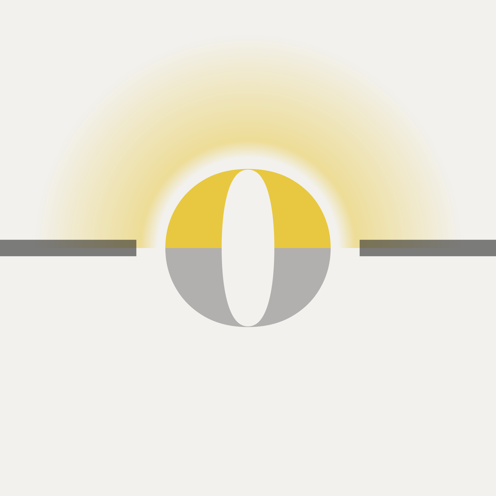
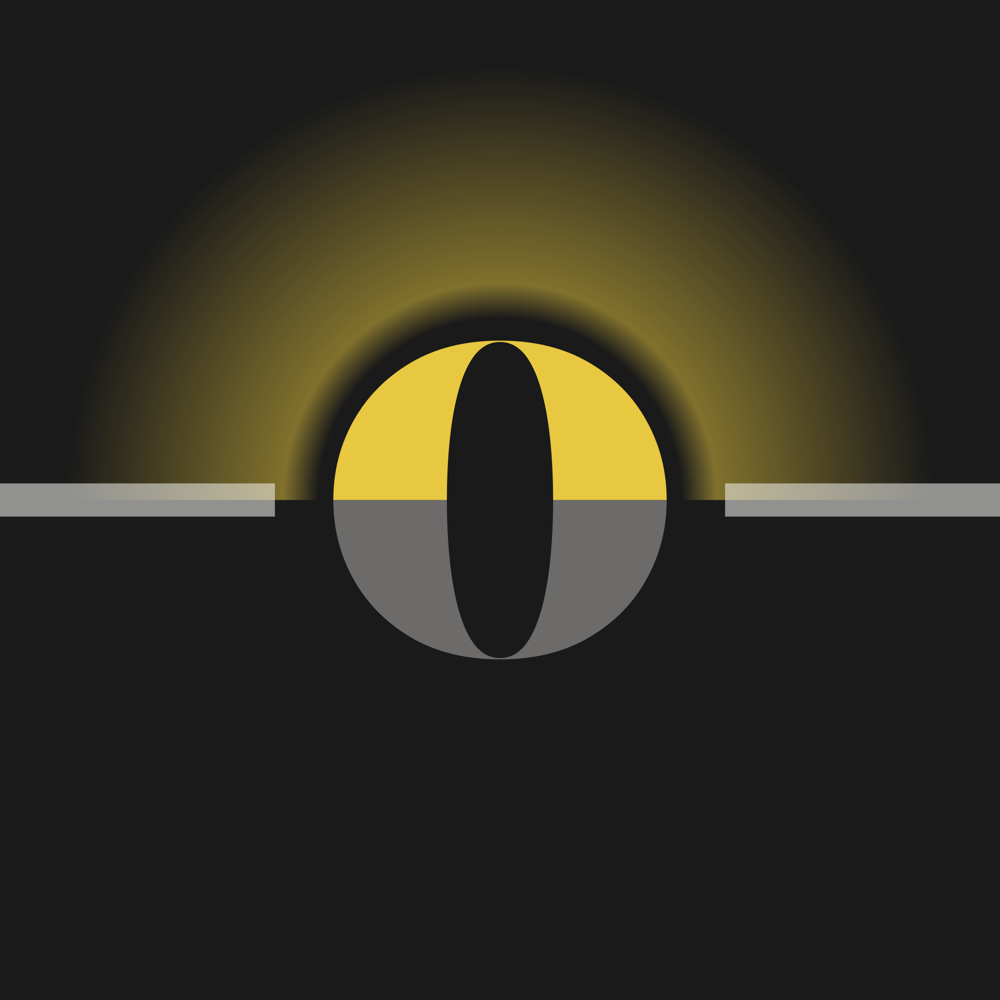

# Identity

This page sets out the palette, the faces, the logo, and the words the site is drawn in, each read from the file that declares it, so any one of them can be reused without reading it out of the stylesheet.

## Palette

Each color is set on each ground in the use its contrast there admits under [WCAG 2.2](https://www.w3.org/TR/WCAG22/): text at 4.5:1 or more, a mark at 3:1 or more, and below that a fill beneath an ink edge.

<!-- identity-palette -->

| **Color** | **Hex** | **Token** | **Meaning** | **On Cararra** | **On Near Black** |
|---|---|---|---|---|---|
| Eureka | `#e8c840` | `--luxout-primary` | The light of a clear sky as the clear-sky curve and the glow, and links on the dark ground | Fill at 1.46:1 | Text at 10.58:1 |
| Toronto | `#5069ad` | `--luxout-accent-1` | The estimate the plugin writes, and links on the light ground | Text at 4.69:1 | Mark at 3.29:1 |
| Seacaller | `#4b8488` | `--luxout-accent-2` | Open-Meteo's forecast | Mark at 3.75:1 | Mark at 4.11:1 |
| Ube | `#8a80cb` | `--luxout-accent-3` | The sun's geometry | Mark at 3.08:1 | Text at 5.00:1 |
| Apricot | `#e8876f` | `--luxout-accent-4` | An area, filled and never drawn as a line | Fill at 2.29:1 | Text at 6.73:1 |
| Chambray | `#7db3e0` | `--luxout-accent-5` | A threshold sensor | Fill at 1.98:1 | Text at 7.79:1 |
| Caramel Coating | `#b77610` | `--luxout-warning` | The fallback to the clear-sky curve | Mark at 3.31:1 | Text at 4.65:1 |
| Brick Red | `#c62d42` | `--luxout-critical` | A sensor showing No Response | Text at 4.82:1 | Mark at 3.20:1 |
| Cararra | `#f2f1ee` | `--luxout-ground` | The light ground, and text on the dark ground | Fill at 1.00:1 | Text at 15.41:1 |
| Near Black | `#1a1a1a` | `--luxout-dark` | The dark ground, and text on the light ground | Text at 15.41:1 | Fill at 1.00:1 |

<!-- /identity-palette -->

## Faces

Each face loads from its [Fontsource](https://fontsource.org/) package across the weight and optical-size axes the theme imports, each span as the package declares it.

<!-- identity-faces -->

| **Role** | **Face** | **Weight** | **Optical Size** | **Italic** |
|---|---|---|---|---|
| `--font-base` | Source Serif 4 | 200 to 900 | 8 to 60 | Yes |
| `--font-display` | Bodoni Moda | 400 to 900 | 6 to 96 | Yes |
| `--font-mono` | JetBrains Mono | 100 to 800 | None | No |

<!-- /identity-faces -->

## Logo

The title and the mark each take one form per ground, drawn from a construction that places the parts below.

<!-- identity-forms -->

| **Form** | **On Cararra** | **On Near Black** |
|---|---|---|
| Title |  |  |
| Mark |  |  |

<!-- /identity-forms -->

<!-- identity-logo -->

| **Part** | **Construction** |
|---|---|
| Horizon | The ink at 55% opacity, across the title from its first letter to its last |
| Break | The horizon stops 1.35 times the sun's radius either side of its center |
| Glow | The sun's color fading out 2.6 times its radius from its center, above the horizon alone |
| Below | The letters under the horizon at 30% of the ink on the light ground and 38% on the dark |

<!-- /identity-logo -->

## Tagline and Byline

The tagline opens the front page, whereas the byline is metadata only, describing the package and every page in its meta description and og:description tags, so no face sets it.

<!-- identity-words -->

| **Line** | **Text** | **Face** | **Where** |
|---|---|---|---|
| Tagline | An outdoor light sensor for Apple Home. | Source Serif 4 italic | The front page’s opening line |
| Byline | A Homebridge light sensor that tells Apple Home how bright it is outside, from the sun's position and Open-Meteo's forecast of sunlight. | None | The package’s description and each page’s meta description and og:description tags |

<!-- /identity-words -->
