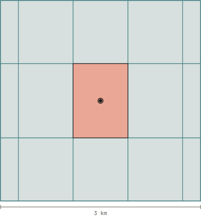

# What *Luxout* Sends

The plugin sends one kind of request, a forecast from [Open-Meteo](https://open-meteo.com/en/docs), and the settings page sends one more, a search, only when you search. Neither carries an API key, and the plugin sends no analytics and no reading of yours anywhere.

## One Request an Hour

<!-- clock-lede -->

The plugin asks [Open-Meteo](https://open-meteo.com/en/docs) for the forecast once an hour, at a minute drawn at random when Homebridge starts, 17 past in the sample install, and retries a failed request as [While Fetches Fail](../estimate/failed-fetches.md#retries) sets out.

<!-- /clock-lede -->

<!-- clock-table -->

| **Tab** | **What the Face Shows** |
|---|---|
| Every hour | One request an hour, at 17 past, a minute drawn at random when Homebridge starts, so 24 requests a day. |
| What it carries | Each request carries the place rounded to two decimals, 42.36, −71.06, which resolves it to about a kilometer, and fetches sunlight at the ground every 15 minutes, from 1 hour before the current step to the step 5 hours and 45 minutes after it. |
| If an hour fails | The 08:17 request fails and is retried at 08:18, 08:20, 08:24, 08:32, and 08:48, each wait twice the last, then nothing more until 09:17, while the reading keeps using the 07:17 forecast. |

<!-- /clock-table -->

Open-Meteo's [terms](https://open-meteo.com/en/terms#privacy) say its free API may collect IP addresses and keeps server logs that may hold the coordinates a request carries, and deletes those logs after 90 days.

## The Place Each Request Carries

<!-- place-lede -->

Each request carries the place rounded to two decimal places, and one forecast cell already spans about 10 of the areas, each holding the points that round to one pair.

<!-- /place-lede -->

Open-Meteo's 15-minute forecast over the contiguous United States comes from RRFS, a model whose cells run 3 km on a side, as its [GFS and RRFS documentation](https://open-meteo.com/en/docs/gfs-api) lists, so the rounding costs the reading nothing a cell could resolve.

<!-- place-table -->

| **Mark** | **Figure** |
|---|---|
| Stored | 42.36, −71.06 |
| Sent | 42.36, −71.06 |
| Rounds to that pair | 1.11 by 0.82 km |
| One forecast cell | 3 km, about 10 areas |

<!-- /place-table -->

## The Search on the Settings Page

The settings page sends the text you search for to [Open-Meteo's geocoding API](https://open-meteo.com/en/docs/geocoding-api) when you submit the search, beside the language the Homebridge UI runs in and a cap on how many places come back. Typing coordinates in by hand sends nothing.

## The One File It Keeps

The plugin keeps the last forecast it fetched in [one file](../estimate/forecast-window.md#the-stored-file) inside the Homebridge storage directory, and writes nowhere else.
