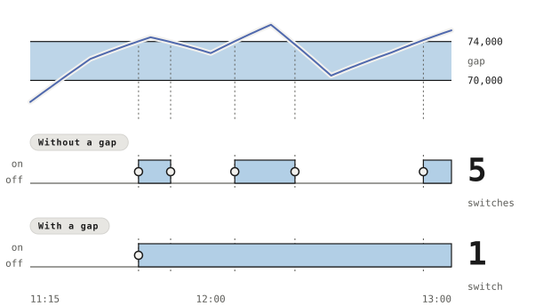

# Threshold Sensors

Each entry under [the threshold levels](../settings/thresholds.md) adds one accessory of its own, an [Occupancy Sensor](https://developers.homebridge.io/#/service/OccupancySensor) that the Home app lists beside *Outside*. Its [`OccupancyDetected`](https://developers.homebridge.io/#/characteristic/OccupancyDetected) reads `1` while the sensor is on and `0` while it is off, and the Home app reads the value and never sets it. The plugin compares both levels against the clamped reading *Outside* shows, once a minute.

## The Gap

A sensor switches on at one level and off only once the reading passes the other, and the span between the two is the gap, inside which the sensor holds the state it has. Each switch can run an automation built on the state the sensor switched to, so without a gap, a reading wavering around one level runs it over and over.

<!-- gap-direction -->

A sensor whose on level of 74,000 lux sits above its off level of 70,000 turns on as the reading rises to the on level and off once it falls below the off level.

<!-- /gap-direction -->

A sensor whose on level sits below its off level runs the other way, turning on as the reading falls and off once it rises past the higher level.

<!-- gap-table -->

| **From 11:15 to 13:00** | **Without a gap** | **With a gap** |
|---|---|---|
| On at | 74,000 lux | 74,000 lux |
| Off below | 74,000 lux | 70,000 lux |
| Switches | 5 | 1 |
| Switches at | 11:42, 11:50, 12:06, 12:21, 12:53 | 11:42 |

<!-- /gap-table -->

A restart alone switches nothing, since a sensor [Homebridge](https://homebridge.io) restores from its cache keeps its state while the first reading sits inside the gap.

## Automations

Each automation below names a sensor and its levels, and [the Home app's own guide](https://support.apple.com/guide/iphone/use-automations-iph6d50ec543/ios) covers the steps. Automations run through a [home hub](https://support.apple.com/en-us/102313).

- **A sensor named *Dark Outside*** with an on level of 2.99 and an off level of 662 turns on as the reading falls to the brightness of the end of civil twilight and off once it rises past the brightness of sunset the next morning, so an automation on it sets the lights to a quarter when it turns on.
- **A sensor named *Glare*** with an on level of 74,000 and an off level of 70,000 turns on as the reading rises, so an automation on it can turn the television on while the room would otherwise sit in glare, and the sensor stays on while a cloud holds the reading at 70,000 or above.
